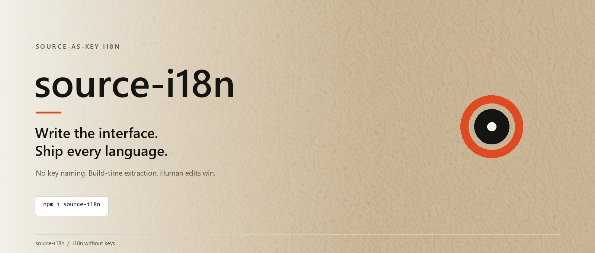
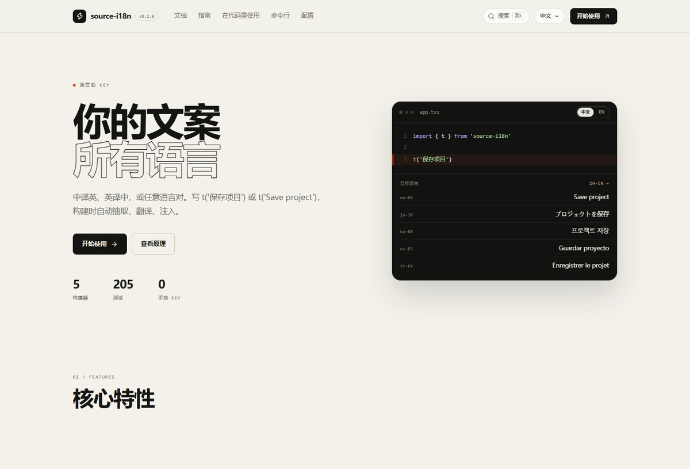

<div align="center">

  <p>
    <a href="https://github.com/wreckglow/source-i18n/blob/main/README.md"><strong>English</strong></a> ·
    <a href="https://github.com/wreckglow/source-i18n/blob/main/readme/zh-CN.md">简体中文</a> ·
    <a href="https://github.com/wreckglow/source-i18n/blob/main/readme/ja-JP.md">日本語</a> ·
    <a href="https://github.com/wreckglow/source-i18n/blob/main/readme/ko-KR.md">한국어</a> ·
    <a href="https://github.com/wreckglow/source-i18n/blob/main/readme/es-ES.md">Español</a> ·
    <a href="https://github.com/wreckglow/source-i18n/blob/main/readme/fr-FR.md">Français</a>
  </p>

  

  <h1>source-i18n</h1>

  <p>
    <strong>Automatic translation for frontend projects.</strong><br />
    Write the interface. Ship every language.
  </p>

  <p>
    <a href="https://www.npmjs.com/package/source-i18n"></a>
    
    
    <a href="./LICENSE"></a>
  </p>

  <p>
    <a href="#quick-start">Quick start</a> &nbsp;·&nbsp;
    <a href="#features">Features</a> &nbsp;·&nbsp;
    <a href="#documentation">Docs</a> &nbsp;·&nbsp;
    <a href="#ai">AI</a>
  </p>
</div>



## What it is

source-i18n is an automatic translation tool for frontend projects. Write the
interface in Chinese or English as usual; the build generates English, Japanese,
Korean, Spanish, French and other language versions. No key for every string, no
language files to maintain, no export sheet.

Built for marketing sites, admin dashboards, SaaS products and Electron desktop
apps — with React, Vue, Svelte or plain HTML.

## The idea

Translation keys are a second language your team has to maintain.

`save_project_button_confirm` is not the copy. It is a name someone invented, repeated in a dozen files, and forever separated from the text the user actually reads.

**source-i18n removes the key layer.** The source text is the key.

```tsx
// before
t('save_project_button_confirm')

// after
t('Save project')
```

No key to invent. No export file to hand off. One source string becomes five translations at build time:

| You write | zh-CN | ja-JP | ko-KR | es-ES | fr-FR |
|---|---|---|---|---|---|
| `t('Save project')` | 保存项目 | プロジェクトを保存 | 프로젝트 저장 | Guardar proyecto | Enregistrer le projet |

At build time every `t()` call is extracted, translated through the provider you choose, and injected as a catalog. Human edits are preserved. Missing strings fail CI, not your users.

## Features

| Capability | What you get |
|---|---|
| **No key naming** | The text you write is the identifier. Nothing to invent, rename, or document. |
| **Build-time extraction** | Every `t()` / `$t()` call becomes a catalog entry automatically. |
| **Provider freedom** | OpenAI-compatible APIs, DeepL, Ollama, manual, or your own provider object. |
| **Human edits win** | Machine output is fingerprinted. Once you edit a translation, `sync --force` never overwrites it. |
| **Translation memory** | Rename a source string and the previous translation follows it. |
| **ICU ready** | Placeholders, plurals, number formatting, and `context` for ambiguous words. |
| **CI gate** | `check --strict` blocks missing strings, broken placeholders, stale entries, and dynamic calls. |
| **Safe by default** | Production bundles contain catalogs only: no provider keys, no dev endpoint, no network requests. |
| **Five bundlers** | Vite, Rollup, esbuild, webpack, and rspack. |
| **Five runtimes** | React, Vue, Svelte, vanilla DOM, and Node/Electron. |
| **AI-native** | A built-in MCP server and a portable Agent Skill, not tied to one client. |
| **Six-language docs** | The documentation site is built with source-i18n itself. |

## What it feels like

```tsx
import { useT } from 'source-i18n/react'

export function Toolbar() {
  const t = useT()

  return (
    <button>{t('Save project')}</button>
  )
}
```

Your catalog, after `source-i18n sync`:

```json
{
  "locale": "zh-CN",
  "sourceLocale": "en-US",
  "messages": {
    "Save project": "保存项目"
  }
}
```

Change the language:

```ts
import { setLocale } from 'source-i18n'

setLocale('zh-CN')
```

That is the whole API surface you need to ship.

## Quick start

```bash
npm i source-i18n
npx source-i18n init
```

`init` creates `source-i18n.config.mjs` and `i18n/locales/`, then asks for your source language, target languages, and provider.

The config can be `.mjs`, `.js`, `.cjs` or `.json` — or `.ts` / `.mts` on **Node 22.13+**, where Node strips the types at load time (no bundler, no extra dependency). On Node 20 use the `.mjs` file `init` creates. Node prints a one-line `ExperimentalWarning` the first time it loads a TypeScript config; it is harmless.

Add the plugin:

```ts
// vite.config.ts
import { defineConfig } from 'vite'
import sourceI18n from 'source-i18n/unplugin/vite'

export default defineConfig({
  plugins: [sourceI18n()],
})
```

The bundler adapters are ESM-only (they are built on unplugin 3): load them from an
ESM config — `vite.config.ts`, `rollup.config.mjs`, `webpack.config.mjs`, or any
config file in a package with `"type": "module"`. A CommonJS `webpack.config.js`
has to `await import('source-i18n/unplugin/webpack')` inside a function config.
The runtime itself is dual: `import` and `require` both work for
`source-i18n`, `/react`, `/vue`, `/svelte`, `/vanilla`, `/node`.

Write:

```tsx
<button>{t('Save project')}</button>
```

Run:

```bash
npm run dev
```

Missing strings are visible in the UI and reported in the console. Development auto-translation is **opt-in**: enable `dev.autoTranslate` when you want missing strings sent to your provider, or run:

```bash
npx source-i18n sync
```

## Works with your stack

| Builders | UI | Runtime |
|---|---|---|
| Vite | React 18 / 19 | Browser |
| Rollup | Vue 3 | Node |
| esbuild | Svelte | Electron |
| webpack | Vanilla DOM | SSR |
| rspack | | |

The runtime is tiny and framework-native: hooks for React, composables for Vue, a store for Svelte, `data-i18n` for plain HTML, and a Node adapter for CLIs and desktop main processes.

## Providers

| Provider | Best for |
|---|---|
| **OpenAI-compatible** | Quality and speed: OpenAI, DeepSeek, Moonshot, Groq, OpenRouter, or any compatible endpoint. |
| **DeepL** | European languages and glossary-heavy products. |
| **Ollama** | Fully local translation. Your copy never leaves the machine. |
| **Manual** | You want extraction and validation only. |
| **Custom** | Your own translation service, behind one `translate()` method. |

Keys belong in environment variables — `OPENAI_API_KEY`, `SOURCE_I18N_API_KEY`, `DEEPL_API_KEY`, or `OLLAMA_HOST`. They are read in Node and never shipped to the browser.

## CLI

| Command | What it does |
|---|---|
| `source-i18n init` | Create the config and catalog directory. |
| `source-i18n extract` | List everything that will be translated. Read-only. |
| `source-i18n sync` | Fill missing translations and write catalogs. |
| `source-i18n sync --dry-run` | Show what would happen. No network, no writes. |
| `source-i18n format` | Normalize catalogs; safe to run on every commit. |
| `source-i18n check --strict` | The CI gate: missing, invalid, stale, dynamic. |
| `source-i18n skill --dir .claude/skills` | Install the portable Agent Skill into a client directory. |

`sync` never overwrites human edits. `--prune` only removes machine entries whose source disappeared, and `--prune-manual` is an explicit opt-in.

## AI

The package ships with the interfaces agents actually need.

**MCP server**

```bash
npm i -D source-i18n @modelcontextprotocol/sdk
npx source-i18n-mcp --root /path/to/project
```

Tools: `i18n_extract`, `i18n_check`, and `i18n_sync`. `sync` is dry-run by default and only writes with explicit confirmation. Resources expose a redacted config and the catalogs.

**Agent Skill (portable)**

```bash
npx source-i18n skill --dir <your-client-skills-dir>
```

The skill follows the Agent Skills open standard and is not tied to Claude Code. `.claude/skills/` is simply one client's install directory; other Agent Skills clients load the same folder from their own skills path. Use `--force` to overwrite an existing install.

## Security

- Provider keys stay in Node; the browser bundle contains catalogs only.
- Production builds have no dev endpoint and no dev token.
- The development endpoint requires a per-session token, same-origin requests, and JSON.
- MCP redacts `apiKey`, `token`, `secret`, and `password` fields.
- `npm publish` runs a secret scan over every publishable file.

## Documentation



The documentation is maintained as a separate site: 15 pages covering setup, concepts, API, CLI, configuration, CI, providers, examples, troubleshooting, and AI tools.

It ships in six languages — English, 中文, 日本語, 한국어, Español, Français — with search, an on-this-page table of contents, and locale-prefixed URLs.

## Tradeoffs

source-i18n is opinionated. It is a good fit when:

- your team writes copy directly in the product;
- you want translations to happen as part of the build, not a separate portal;
- you care more about shipping than about maintaining a key registry.

It is not the right tool for runtime user-generated content, backend error strings, or translation workflows that require a full TMS with translator roles and approval chains.

Changing a source string creates a new catalog entry. That is the cost of source-as-key — and why translation memory exists.

## Status

- `209` tests, including real bundlers and a real browser
- Node.js `>= 20`
- MIT licensed
- Package: [`source-i18n`](https://www.npmjs.com/package/source-i18n)
- Source and issues: [`wreckglow/source-i18n`](https://github.com/wreckglow/source-i18n)
- Contact: [wreckglow@gmail.com](mailto:wreckglow@gmail.com)

## Disclaimer

source-i18n is provided "as is", without warranty of any kind; see [LICENSE](./LICENSE).

- Machine translations come from third-party providers and can be wrong. Review the catalogs before shipping; the maintainers are not liable for translation errors, omissions, or their consequences.
- The source strings you choose to translate are sent to the provider you configure (an OpenAI-compatible endpoint, DeepL, Ollama, your own provider, or the model behind your MCP client). That data and any API cost are between you and the provider.
- Do not rely on machine translation where a wrong rendering could cause harm — medical, legal, safety, financial, or regulated content — without human review.

## License

MIT © source-i18n contributors

<br />

<div align="center">
  <sub>Write the interface. Ship every language.</sub>
</div>
